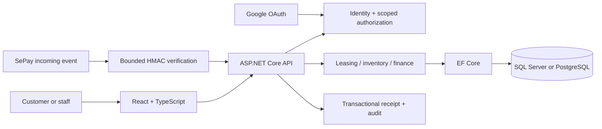

# KhoSpace

### Warehouse leasing, inventory operations, and traceable payments.

A full-stack application for a business renting fixed warehouse units to multiple
customer organizations. KhoSpace connects the rental lifecycle with day-to-day
stock movements, receivables, and bank-transfer reconciliation.

**C# / ASP.NET Core 10 · React 19 · TypeScript · EF Core · SQL Server / PostgreSQL**

[Explore the website](https://khospace-eight.vercel.app) ·
[Read the SRS](docs/requirements/SRS.md) ·
[Understand the architecture](docs/design/architecture-api.md) ·
[Follow the demo](docs/demo-script.md)

> Portfolio project under active development. Documentation is written in English;
> the customer-facing interface is intentionally Vietnamese. The hosted application
> is not an unrestricted test environment: do not create real payment requests or
> transfer funds merely to explore the project.

## What It Does

| Area | Capabilities |
| --- | --- |
| Warehouse leasing | Multiple facilities, fixed-area units, date-based reservations, and overlap prevention |
| Contract lifecycle | Confirmation, same-unit renewal, contract versioning, unchanged-deposit renewal, termination, and unit closure |
| Inventory | Inbound/outbound requests, balances, adjustments, reversals, inter-unit transfers, and barcode workflows |
| Finance | Deposits, rent, receipts, settlement, receivables aging, CSV exports, and overdue reminders |
| Customer access | Email/password accounts, optional Google OAuth, organization boundaries, and role-scoped operations |
| Online payments | Provider adapters for VNPAY and MoMo; SePay bank-transfer QR with signed callbacks and durable deduplication |
| Operations | Gate visits, monthly tariffs, private documents, notifications, health checks, and build identity |

Availability depends on deployment configuration and the user's permissions.
An implemented adapter is not a claim that every payment provider is activated.

## Why This Project

Warehouse rental is more than a CRUD catalog. A usable workflow must prevent
overlapping reservations, isolate customers' stock, preserve contract history,
and distinguish a bank event from an accounted payment.

This project focuses on explicit state transitions, transactional writes, scoped
authorization, repeat-safe commands, and relational tests. It is designed as a
full-stack internship portfolio with explainable business rules.

See [engineering decisions and interview talking points](docs/portfolio.md).

## Architecture



- `backend/WarehouseRent.Api`: HTTP endpoints, authentication, workflow services,
  cloud startup boundaries, and health/build identity.
- `backend/WarehouseRent.Infrastructure`: entities, persistence, Identity, and migrations.
- `backend/WarehouseRent.Tests`: unit and relational integration tests.
- `frontend`: React features, Vietnamese UI copy, responsive styles, and tests.
- `docs`: requirements, architecture, business rules, workflow guides, and test strategy.
- `ops`: explicit setup, packaging, inspection, and deployment-export utilities.

The hosted deployment uses Vercel for the frontend/proxy, Render for the API, and
PostgreSQL. Local synthetic-demo instructions below use SQL Server. Production
PostgreSQL bootstrap is intentionally ownership-bound; do not reuse it against
an arbitrary project or another application's database.

## Quick Start

### 1. Prerequisites

Use the versions pinned by `global.json`, `toolchain-versions.json`, and
`frontend/package.json`:

- .NET SDK **10.0.403**
- Node.js **24.19.0**
- npm **11.17.0**
- A local SQL Server instance with permission to create a synthetic database
- PowerShell 7 for the Windows examples and operations scripts

Do not use a production database for setup, seeding, or integration tests.

### 2. Clone and restore

```powershell
git clone https://github.com/Sonness1304/khospace.git
Set-Location khospace
dotnet restore backend/WarehouseRent.sln --locked-mode
dotnet tool restore
npm --prefix frontend ci --ignore-scripts --no-fund
```

This public portfolio repository can be cloned without a GitHub account.
No production credentials are included; the deployment repository remains private.

### 3. Initialize a synthetic local demo

```powershell
$env:DOTNET_GENERATE_ASPNET_CERTIFICATE = 'false'
$env:ASPNETCORE_ENVIRONMENT = 'Demo'
$env:ConnectionStrings__WarehouseRent = 'Server=localhost;Database=WarehouseRent_Demo_Local;Integrated Security=True;Encrypt=True;TrustServerCertificate=True'
dotnet run --project backend/WarehouseRent.Api -- --migrate
dotnet run --project backend/WarehouseRent.Api -- --seed-demo
dotnet run --project backend/WarehouseRent.Api -- --urls http://127.0.0.1:5080
```

This is a local Windows integrated-authentication example.
`TrustServerCertificate=True` is a development exception, not production TLS
guidance. A reachable SQL Server and appropriate local privileges are required.

Migration and seeding are explicit one-shot operations. Normal startup does not
silently migrate or seed. Demo initialization enforces its environment and
database-name restrictions.

### 4. Start the frontend

In a second terminal:

```powershell
npm --prefix frontend run dev
```

Open `http://127.0.0.1:5173`. Vite proxies `/api` and `/health` to port 5080.
Keep both terminals open.

### 5. Explore the synthetic workflows

The explicit demo seed creates synthetic accounts only. Its public
**local-demo-only** password is `WarehouseRent_Demo!42`.

| Account | Role |
| --- | --- |
| `admin.a@example.test` | Customer A administrator |
| `admin.b@example.test` | Customer B administrator |
| `clerk@example.test` | Warehouse clerk |
| `sales@example.test` | Sales |
| `finance@example.test` | Finance |
| `operator@example.test` | Operator administrator |

Never reuse demo credentials in a public deployment. Follow the
[demo script](docs/demo-script.md) for booking, stock, and finance scenarios.

## Verification

### Checks without a database

```powershell
node --test tests/*.test.mjs
npm --prefix frontend run lint
npm --prefix frontend test
npm --prefix frontend run build
```

### Relational integration tests

The SQL Server suite creates and removes its own uniquely named
`WarehouseRent_Demo_Test_*` databases. Review its target before running:

```powershell
dotnet build backend/WarehouseRent.sln --no-restore
dotnet test backend/WarehouseRent.sln --no-build --collect:'XPlat Code Coverage'
```

The alternate PostgreSQL fixture is explicitly selected with
`WAREHOUSERENT_TEST_PROVIDER=PostgreSqlFixture`. It requires the configured,
agent-owned synthetic loopback fixture; setting the variable alone does not start
PostgreSQL. See [PostgreSQL bootstrap](docs/postgres-bootstrap.md).

### Recorded source verification

The November 7, 2026 verification of application source
`cfb55e69caed52350ce38adca6a83e90c660ddb4` recorded:

| Scope | Result |
| --- | --- |
| Selected backend/payment/PostgreSQL checks | 195 passed, 0 failed, 0 skipped |
| Frontend tests | 366 passed across 38 files |
| Node operations/export checks | 104 passed |
| Frontend lint, type check, and build | Exit 0 |

These are revision-specific records, not a guarantee that every test has run in
GitHub or every production workflow is accepted. Browser, hardware, Google-consent,
and real-money acceptance are tracked separately.

GitHub CI is **manual-only** (`workflow_dispatch`). No deployment runs on push.

## Security and Payment Boundaries

- Cookie authentication, CSRF, authorization, and tenant boundaries remain
  server-enforced; hiding a UI control does not change permission.
- Production OAuth secrets, database passwords, webhook keys, Data Protection keys,
  bank records, local credentials, and backups are not distributed here.
- A QR image, browser return URL, screenshot, or user statement is not proof of payment.
  A verified event must match the intended recipient, reference, and amount.
- SePay callbacks use bounded raw-body HMAC verification, timestamp freshness,
  durable event identity, and transactional receipt/audit handling.
- A receipt does not automatically allocate money to deposit or rent.
  Expired, cancelled, or conflicting evidence requires reconciliation.
- Live SePay configuration was enabled on the hosted deployment; a real transfer
  through provider delivery, receipt, and customer readback is **not yet verified**.
- Free hosting/provider plans have limits. No unlimited-free or fee-cap claim is made.

Read [security reporting](SECURITY.md) and the [SePay guide](docs/sepay-payments.md)
before changing authentication, finance, or deployment behavior.

## Documentation

| Start here | Purpose |
| --- | --- |
| [Product brief](docs/requirements/product-brief.md) | Business model, scope, and decisions |
| [SRS](docs/requirements/SRS.md) | Functional and non-functional requirements |
| [Business rules](docs/requirements/business-rules.md) | Invariants and state machines |
| [Data model](docs/design/data-model.md) | Entities, relationships, and dictionary |
| [Architecture and API](docs/design/architecture-api.md) | Boundaries and contracts |
| [UX design](docs/design/ux-design.md) | Journeys, roles, and interaction design |
| [Test strategy](docs/testing/test-strategy.md) | Acceptance scenarios and checks |
| [Traceability](docs/testing/traceability.md) | Requirements mapped to tests/work packages |
| [Portfolio guide](docs/portfolio.md) | Technical decisions and interview preparation |

## Project Status

This is a learning and portfolio application with implemented P0/P1/P2 source
workflows and a hosted deployment, not a certified warehouse, accounting, legal,
tax, banking, or security product.

Historical work-package reports retain their dates and revisions; they do not
override current acceptance limits. Future work includes real-provider acceptance,
broader mobile/accessibility checks, recovery exercises, and deployment portability.

This is a clean source snapshot with English repository documentation, without
private Git history, local QA artifacts, credentials, customer data, backups, or
deployment repositories' private configuration.

## License

KhoSpace source and documentation are available under the [MIT License](LICENSE).
Third-party dependencies retain their own licenses.

See [contributing](CONTRIBUTING.md) for safe development and review expectations.
