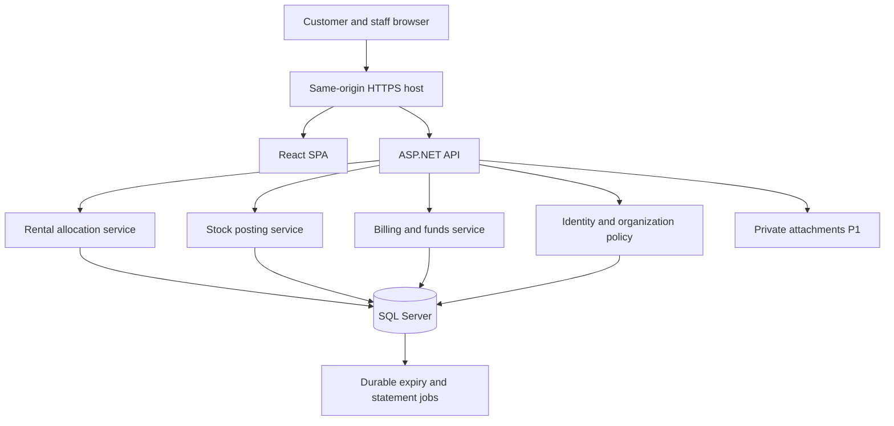

# Architecture and API contracts

Proposed baseline, awaiting design approval. Exact installed/resolved package versions will be pinned before code. No application scaffold exists yet.

## Architecture choice

Modular monolith: one ASP.NET Core 10 API, one React/TypeScript SPA, one SQL Server database and a private attachment store in P1. Modules are Identity/Organizations, Facilities, Rentals, Inventory, Billing and Operations. Feature folders keep controller/command/domain policies/tests close. Avoid microservices, message brokers, event-sourcing infrastructure and generic repository abstractions without a demonstrated need.

Local developer layout proposed: `backend/WarehouseRent.Api`, `backend/WarehouseRent.Domain`, `backend/WarehouseRent.Infrastructure`, `backend/WarehouseRent.Tests`, `frontend/src/features`, `frontend/e2e`, `ops/`. Keep application use cases in feature folders within Api initially; do not create empty layers for every noun.

## Identity and session design

ASP.NET Identity for password hashing/lockout and server-protected cookie sessions. Same-origin SPA/API with CSRF token on mutations. No access token stored in localStorage. Account/membership disable is checked during session validation; customer organization context must be a current membership, staff facility context an assignment. Secrets through User Secrets/env, never committed. Local demo users seeded only under explicit Demo environment.

## Shared API conventions

Base `/api/v1`. JSON camelCase; UUIDs; ISO `YYYY-MM-DD` rental dates; UTC ISO event timestamps; currency VND, amounts/quantities serialized as decimal strings to avoid JavaScript precision loss. Lists `{items,nextCursor,totalCount?}`; pageSize default50/max100; stable sort includes ID. Client display does not recalculate authoritative totals.

Writes use `Idempotency-Key` (UUID) and `If-Match` for versioned existing records. Missing precondition for mutable document edits returns 428, stale rowversion 412, business state/overlap/duplicate payload conflict 409, field validation 422, unauthorized 401, inaccessible customer object 404, forbidden action 403, throttle 429. Error ProblemDetails extension: `code`, `correlationId`, `errors` (safe field messages). Never return stack traces or foreign-customer conflict details.

Command receipt: `{commandId,status,resourceType,resourceId,version}`. GET `/commands/{id}` restricted to initiating actor/org or authorized staff. Store command result in the business transaction. A lost response is resolved through readback; a P0 UI disables duplicate clicks but correctness does not depend on that.

## Endpoint inventory

| Module | Endpoint | Authorization / behavior |
| --- | --- | --- |
| Identity | POST `/auth/login`, `/auth/logout`; GET `/auth/me`, `/auth/csrf` | Generic login errors; protected cookie and CSRF contract |
| Organizations | GET `/organizations/current`; POST/PATCH `/memberships` for existing users P0; DELETE `/memberships/{id}`; POST `/invitations` P1 | Own customer admin; last-admin rule; operator role cannot be self-granted |
| Catalog | GET `/public/facilities`, `/public/facilities/{id}/units` | Published projections only |
| Facilities | POST `/facilities/{id}/units`; PATCH `/units/{id}`; POST `/maintenance-blocks` | Manager+facility; version/overlap rules |
| Availability | GET `/availability?facilityId&startDate&endDate&minArea` | Indicative eligible whole units, no customer identities |
| Quotes | POST `/quotes`; GET `/quotes/{id}` | Customer admin/sales; snapshot calculation |
| Holds | POST `/quotes/{id}/holds`; GET `/bookings/{id}` | Atomic multi-unit allocation; returns expiresAt |
| Confirmation | POST `/bookings/{id}/confirm`, `/cancel`; POST `/leases/{id}/cancel` | Cancel routes invoke one CancelRental command for booking+Scheduled lease; verify deposit/time under lock |
| Leases | POST `/bookings/{id}/lease`; GET `/leases`, `/leases/{id}` | One lease per booking |
| Handover | POST `/leases/{id}/handover`, `/physical-clearance` P0; `/close` P1 | Manager+facility; physical clearance separate from financial closure; lock occupancy |
| Amendments | POST `/leases/{id}/amendments`, `/termination` P1 | Versioned proposal then approved transition |
| Items | GET/POST `/items`; PATCH `/items/{id}` | Own customer inventory; immutable UOM after posting |
| Stock requests | POST `/stock-requests`; POST `/{id}/submit`, `/{id}/approve` | Customer submit; staff approval |
| Posting | POST `/stock-requests/{id}/post` | Clerk+facility, observed actuals; complete P0 request only |
| Corrections | POST `/stock-postings/{id}/reverse`; POST `/stock-counts` P1 | Manager rules; linked correction |
| Stock query | GET `/stock-balances`, `/stock-ledger` | Organization/facility scoped and paginated |
| Billing | POST `/leases/{id}/statements`; GET `/statements/{id}` | Finance generate; customer own read |
| Funds | POST `/receipts`, `/receipts/{id}/verify`, `/receipts/{id}/allocations` | Finance only; separate deposit/charge target |
| Settlement | POST `/leases/{id}/deposit-settlement`, `/statements/{id}/credits` P1 | Finance+reason; linked records |
| Operations | GET `/operations/calendar`, `/operations/conflicts`, `/audit` | Scoped staff; no automatic conflict resolution |
| Documents | POST/GET `/attachments/{id}` P1 | Private aggregate authorization, scan state |
| Reports | GET `/reports/utilization`, `/reports/aging`; GET `/exports/{id}` P1 | Explicit range, scoped rows, formula-safe CSV |
| Health | GET `/health/live`, `/health/ready` | Minimal public liveness; detailed dependencies protected |

## Important request/response examples

`POST /quotes`: `{facilityId,organizationId,unitIds:[...],startDate:"2026-11-01",endDate:"2026-11-05"}`. `organizationId` must match selected membership; never trust it without authorization. Response includes quoteId, expiresAt, line snapshots, rentalSubtotal and requiredDeposit as separate amounts.

`POST /quotes/{id}/holds`: `{expectedQuoteVersion}`. Server returns bookingId/state Held/expiresAt/unitIds. It rechecks all eligible units under parent locks. No client override for price/hold deadline.

`POST /stock-requests/{id}/post`: `{expectedVersion,lines:[{requestLineId,actualQuantity:"12.000"}],note}`. Server resolves customer/item/location from approved request, not arbitrary supplied inventory IDs. Response links posting and resulting balance versions.

`POST /receipts/{id}/allocations`: `{expectedVersion,targetType:"Deposit",targetId:rentalAccountId,amount:"80000"}`. RentalAccount is created with the hold, has the same customer, and survives cancellation/expiry. A lease attaches to it once; no fund migration or polymorphic booking/lease FK. Lock account and receipt under the same ordered funds protocol. A late receipt remains unapplied/refund-needed and cannot revive capacity.

## Critical transaction sketches

**Allocate:** validate identity/shape → begin transaction → load/check idempotency → lock sorted units → database UTC/quote-version/overdue-occupancy check → ignore logically expired holds → overlap query → write all allocations+booking+audit+command result → commit. Rate/area/policy drift yields REQUOTE_REQUIRED; never silently apply a new price.

**Post stock:** validate staff → begin → lock request → confirm state/customer/lease → lock/create balance keys safely → insufficient-stock check → append ledger+projection+fulfillment+audit+command result → commit.

**Generate statement:** begin → lock lease version/period → compute date intersection and snapshot rates → insert unique generation key + lines → audit/result → commit. Duplicate key returns original, not a second invoice.

**Record verified funds:** lock receipt and target → verify status/cross-customer constraints → check amount limits → allocation/deposit journal+audit/result → commit. No external bank call in P0.

All commercial flows follow the shared lock hierarchy in the data model (units when applicable → booking/account → receipts → targets). Verification rechecks booking state under the account lock; cancellation/expiry routes funds to a visible finance review filter without reviving allocation. Proposed demo service target: finance reviews unmatched/refund-needed receipts within two business days; a refund-needed flag never claims money was transferred. No automatic hold extension follows evidence upload. Quote expiry and hold expiry are independent: an expired hold always needs a new explicit hold command, full availability/version checks and possibly a new quote.

## Failure and deployment design

Cancellation tokens flow through database operations. Bounded retries only for known transient database failures and with original command identity. A timeout after commit is not evidence of failure. Background work is database-backed and restart-safe; no in-memory-only expiry authority.

CI later runs `dotnet build/test`, frontend lint/typecheck/build/unit tests, SQL Server integration and browser journeys. Use actual SQL Server for overlap/locking/funds tests; SQLite/InMemory cannot substantiate those semantics. Container use is optional until a local/container runtime is verified. Deployment/paid hosting and real secrets require a separately reviewed target.
