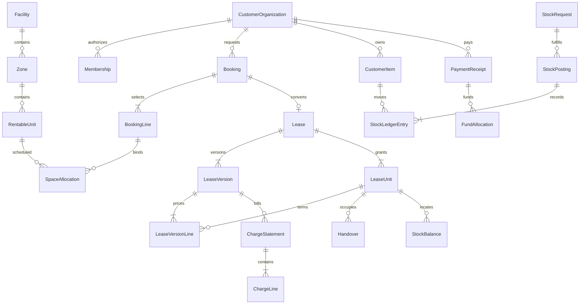

# Data model and dictionary

Proposed SQL Server relational model. UUID primary keys use `uniqueidentifier`; user identifiers follow ASP.NET Identity. Every mutable aggregate has SQL Server `rowversion`; timestamps are `datetimeoffset` UTC, rental boundaries `date`. Rowversion is a stale-edit detector, not the interval-exclusion mechanism.

## Entity relationships

## Entity dictionary

| Entity | Key fields / type | Constraints and ownership |
| --- | --- | --- |
| CustomerOrganization | Id, Code nvarchar(40), Name nvarchar(200), Status | Code unique; operational disable preserves references |
| Membership | UserId, OrganizationId, Role, Active | Unique user/org; at least one active customer admin |
| StaffFacilityScope | UserId, FacilityId, StaffRole | Explicit composite scope; operator admin separate |
| Facility | Id, Code, Address, TimeZoneId, Status | Code unique; initial timezone Asia/Ho_Chi_Minh |
| Zone | Id, FacilityId, Code | Unique facility/code |
| RentableUnit | Id, FacilityId, ZoneId, Code, AreaM2 decimal(12,2), State, Version | Area >0; unique facility/code; no rentable overlapping parent/children |
| RateVersion | Id, UnitId, SalesValidFrom/To date, DailyRate decimal(18,4), Currency char(3) | Non-overlapping sales-validity ranges; selected on quote creation local date, one rate for full term; VND P0 |
| Quote / QuoteLine | OrgId, FacilityId, ExpiresAt, UnitId, MonthSegmentStart/End, Area/Rate/PolicySnapshot, RoundedAmount | Unit×calendar-month lines; quote sums the exact same rounded lines later billed; all one customer/facility |
| Booking / BookingLine | OrgId, QuoteId, State, UnitId, Start/End, RequiredDeposit decimal(18,0) | Unique source quote conversion policy; customer/quote match; line units unique |
| SpaceAllocation | UnitId, Start/End date, State, HoldExpiresAt, BookingLineId?, LeaseUnitId?, MaintenanceId? | Exactly one owning source; Start<End; all writers use unit locking transaction |
| MaintenanceBlock | FacilityId, Reason, From/To, State | Allocations link each affected unit; audited |
| Lease | OrgId, BookingId, Code, State, CurrentVersion | BookingId unique; Code unique; cancellation/closure reason |
| RentalAccount | Id, OrgId, BookingId, LeaseId?, State | BookingId unique; created at hold, retained after cancellation/expiry, lease attaches once; stable deposit/funds target |
| LeaseUnit | Id, LeaseId, UnitId, InitialAllocationId | Stable physical space grant across versions; stock/handover keep identity through renewal |
| LeaseVersion / LeaseVersionLine | LeaseId, VersionNo, LeaseUnitId, segment dates, Policy/Area/RateSnapshot | Immutable commercial lines; effective segment set partitions chargeable dates without overlap; superseded future segments retained as history |
| Handover | LeaseUnitId, HandedOverAt, ClearedAt?, ConditionNote, Actor | One uncleared occupancy per physical unit; clear only after zero goods and check |
| CustomerItem | OrgId, SKU nvarchar(80), Description, BaseUom | Unique org/SKU; BaseUom immutable after first posting |
| StockRequest / Line | OrgId, LeaseId, UnitId, Type, State, ItemId, RequestedQty decimal(18,3), FulfilledQty | Item/lease/unit organization match; 0<=fulfilled<=requested |
| StockPosting | OrgId, RequestId, OperationKey, Type, PostedAt, ReversalOfId?, Reason | Unique P0 RequestId; P1 unique source line/fulfillment sequence; linked reversals |
| StockLedgerEntry | PostingId, OrgId, ItemId, UnitId, LeaseUnitId, Delta decimal(18,3), ReversalOfEntryId? | Nonzero delta; append-only; paired transfer entries |
| StockBalance | OrgId, ItemId, UnitId, LeaseUnitId, Qty decimal(18,3), Version | Composite PK; Qty>=0; projection updated in same posting transaction |
| ChargeStatement / Line | OrgId, LeaseVersionId, PeriodStart/End, State, DueDate, type, Days, Rate/AreaSnapshot, Amount decimal(18,0) | Unique generation business key; immutable after issue; credit references original |
| PaymentReceipt | OrgId, Reference, Amount decimal(18,0), ReceivedAt, Status, VerifiedBy | Amount>0; method/reference dedup check; business review before verify |
| FundAllocation | ReceiptId, TargetType, TargetId, Amount | Positive amount; same customer; receipt and target totals locked/check enforced |
| DepositTransaction | RentalAccountId, Type, Amount, SourceReceipt/Settlement, Reason | Exists before/without lease, separate deposit journal; no over-refund |
| Attachment | OrgId, AggregateType/Id, StorageKey, Hash, Mime, Bytes, State | Private; authorization inherited from referenced aggregate |
| AuditEvent | ActorId, OrgId?, FacilityId?, Action, AggregateId, CorrelationId, At, Reason | Append-only nonsecret metadata, transactional when required |
| IdempotencyRecord | ActorId, OrgId, Operation, Key, PayloadHash, State, ResourceId, StatusCode | Unique scope/key; bounded response projection; no secrets |
| OutboxMessage | Type, AggregateId, BusinessKey, Status, Attempts, AvailableAt | Unique type/business key; no false delivery from enqueue |

## SQL invariants and locking

1. Space allocation writers acquire `UPDLOCK,HOLDLOCK` on the parent RentableUnit rows inside a transaction, sorted by ID. Under this common parent-row lock they inspect active overlapping allocations and write them. Nonexistence of an allocation is not itself sufficient lock protection.
2. Every path including maintenance/renewal/admin tools uses the same allocation service. Unique unit/start is insufficient for arbitrary overlaps. No reliance on an EF query followed by an unlocked insert.
3. For stock, request and existing balance rows are locked in stable key order; missing balance keys are safely created/locked using unique keys and serializable range protection. A check constraint on Qty>=0 is a final defense, not the complete posting algorithm.
4. Parent-child ownership is enforced with explicit composite alternate keys/FKs where feasible, plus aggregate validation. A global query filter alone is not a security boundary.
5. Fund allocations lock receipt and target rows before summing/adding. Unique job/statement business keys protect repeated commands beyond idempotency key retention.
6. Occupancy activation locks unit/handover state; a filtered unique constraint on active occupancy's UnitId backs the one-physical-occupant invariant. Clearance and handover use the same service.

Commercial command lock hierarchy: sorted unit IDs (if capacity changes), then Booking/RentalAccount, then sorted receipt IDs and charge/deposit target IDs. Cancellation, confirmation and finance verification never acquire these in reverse order. Finance-only verification locks the account before receipts, rechecks booking state, records real received funds even after cancellation, and leaves late/cancelled funds unapplied or refund-needed. It cannot confirm or reacquire capacity. All paths append audit and command results in the same transaction. Test both cancel-first and verify-first schedules on SQL Server; deadlock retry retains command identity.

## Index plan

Allocations `(UnitId,StartDate,EndDate)` include state/expiry; quote/hold expiry by state+deadline; leases `(OrgId,State,EndDate)`; ledger `(OrgId,ItemId,UnitId,PostedAt,Id)`; statement `(OrgId,DueDate,State)`; outbox `(Status,AvailableAt)`; audit `(AggregateId,At)`.

Validate actual plans against synthetic size targets; do not add broad indexes merely from this proposal. Search uses indexed filters and server pagination, never returns all ledger rows to React.

## Mutability, deletion and migration

Draft quotes/requests may be edited only under a version token before submission. Posted ledger entries, issued charges and verified receipts are corrected through explicit referenced records. Referenced master records are retired, not cascade-deleted.

Migrations are versioned and reviewed. Seed only synthetic data in demo/test environments. Backups use database-supported consistent snapshots plus a corresponding attachment manifest. No operational data import is part of the first portfolio slice.

Before P1, rehearse upgrade of a populated P0 database: each existing full StockPosting becomes its original single fulfillment, with unchanged IDs/ledger deltas; backfill fulfillment references before replacing unique RequestId with fulfillment uniqueness. Keep Type and nullable ReversalOfId from P0. A P1 reversal may reference a P0 posting, respecting quantities already consumed/reversed. Assert balances/history unchanged by upgrade and correct after reversal; never rewrite P0 history to simulate partial posting. Include upgrade/rollback compatibility evidence in WP14.
