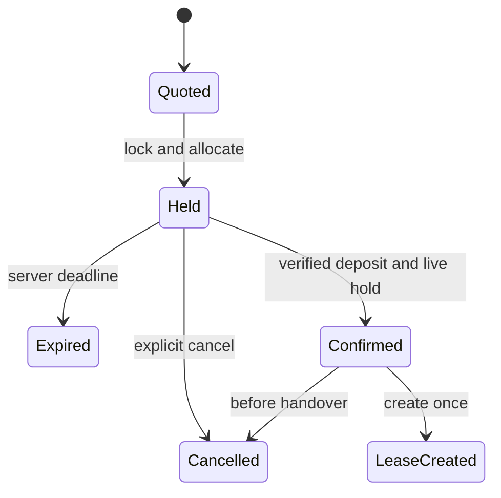

# Business rules and state machines

Status: owner approved proposed demo policies on October28,2026 for P0. Rules are normative within the approved design; P1 rules remain future scope and no rule establishes legal or market validity.

## Space and time rules

| ID | Rule |
| --- | --- |
| BR-001 | Rent whole fixed units. A 20m² unit is billed/allocated as 20m² even if the customer needs 12m². All lines in one booking belong to one facility and one customer. |
| BR-002 | Rental interval is `[startDate,endDate)` in Asia/Ho_Chi_Minh. Minimum 1, maximum 365 calendar days. End date is excluded; adjacent intervals may coexist. New bookings start on/after the facility's current local date. |
| BR-003 | Two allocations overlap when `a.start < b.end && b.start < a.end`. Active holds, confirmed bookings/leases and maintenance blocks participate. Quotes and expired/released holds do not. |
| BR-004 | Acquire locks for every affected unit in stable ID order and perform overlap checks/inserts in one database transaction. Either every requested unit is allocated or none is. Applies to booking, renewal, maintenance, release and change. |
| BR-005 | Holds expire 15 minutes after authoritative database UTC creation time. `now >= expiresAt` is expired. Confirmation evaluates database UTC after acquiring the same allocation locks; exactly one outcome wins. Delayed cleanup does not keep expired capacity blocked. |
| BR-006 | A quote expires after 24 hours and does not hold space. A rate version is selected by the facility-local quote creation date (sales-validity), then applies to the entire quoted rental term. Future sales-rate versions do not segment that term. If the currently sellable rate/area/policy version changed before hold acquisition, return REQUOTE_REQUIRED and require acceptance of a fresh quote. A successful hold freezes accepted terms until expiry; later rate changes never reprice it. |
| BR-007 | Physical occupancy persists until manager clearance. A scheduled term end or canceled allocation does not clear goods. If overdue occupancy threatens a later booking, create an operational conflict; refuse handover, flag affected customers and require manager action. Refuse new unconditional holds on a unit with unresolved overdue occupancy, even for future dates; P0 has no conditional/waitlist booking. Never double-occupy, forcibly move goods or auto-dispose them. |
| BR-008 | Unit splitting/merging or changing leasable area with any future commitment is forbidden. Make new units/versions only after explicit migration/clearance; no shared parent unit that can be rented concurrently with its children. |

## Commercial rules

| ID | Rule |
| --- | --- |
| BR-009 | Split each quoted unit interval into calendar-month segments. Each quote/statement segment line = area snapshot × daily m² rate snapshot × segment days, rounded once to whole VND AwayFromZero. Quote subtotal is the sum of these exact monthly segment lines, and unchanged lease statements reuse them: rounding the whole term first is forbidden. No real tax rate is assumed. |
| BR-010 | Deposit = 20% of the quote's summed monthly segment subtotal, rounded to whole VND. A stable RentalAccount is created with the held booking and remains if cancelled/expired; the later lease attaches to that account. Deposit entries/fund allocations target RentalAccountId, never a polymorphic booking-or-lease key. It is refundable security, not a statement payment/revenue. |
| BR-011 | For demo, finance verifies the full required deposit while the hold is live, then sales confirms. A receipt received after expiry enters unapplied funds/refund review. Capacity is not reallocated without a new availability/price decision. |
| BR-012 | Before any handover, one CancelRental command cancels booking plus any Scheduled lease and releases unoccupied allocations atomically, regardless of whether lease conversion happened. Cancellation never erases receipts or marks refunds paid. Demo default no pre-handover penalty; account retains refund-needed funds. P0 statements cannot be issued before activation, so this cancellation has no issued rental charge to credit. After activation use P1 termination/correction. |
| BR-013 | Statements are issued only after lease activation in P0 and use the agreed scheduled dates, even if handover was later; owner must review this demo policy. Calendar-month charge segments reference immutable LeaseVersionLines and never cover a unit/date twice. Unique generation keys plus covered-period validation prevent duplication across amendments. Paid/issued statements are corrected through credits/supplements in P1. |
| BR-014 | A renewal creates commercial version lines for added dates and rechecks units; unchanged physical LeaseUnit grants keep their identity, occupancy and stock. No new handover for a continuously occupied unchanged unit. Removed units require clearance/zero stock. Old snapshots/issued charges stay; active billing segments partition dates without overlap. No automatic renewal/late fee/extension P0. |
| BR-015 | Receipt amount >0. Verified allocated amounts never exceed received funds or target outstanding. Deposit and rental allocations are different target types. Every adjustment/refund is a linked transaction, never a destructive edit. |
| BR-016 | Closure requires physical clearance, zero stock in affected units, closed/canceled operational requests, deposit refund/deductions recorded and no unsettled balance. An ended lease may remain ClearancePending or SettlementPending. Withdrawal of money is manual and not performed by this application. |

Example: unit 20m² at 5,000 VND/m²/day, Jan 30 to Feb 3 = 4 days, 400,000 rental subtotal, 80,000 refundable deposit. January slice Jan30–Feb1 = 200,000; February slice Feb1–Feb3 = 200,000. The deposit does not reduce either charge statement. These are illustrative amounts, not market rates.

## Custody and stock rules

| ID | Rule |
| --- | --- |
| BR-017 | Customer goods remain customer-owned. Item uniqueness is organization/SKU; balances include organization, item, unit and lease allocation. No implicit organization fallback. |
| BR-018 | Customer creates a request; assigned clerk posts observed quantities. Submitted/approved requests do not change stock. Receipts require Active lease and handed-over unit within term. After term end, manager approval of an issue request records clearance authorization, allowing the clerk to release existing goods in P0; new receipts are refused. Manager physical clearance is also P0; final financial closure is P1. |
| BR-019 | Quantities >0 in one item base UOM with at most 3 decimals. No unit conversions, monetary inventory valuation, lot/expiry/serial tracking in P0. User-entered volume/weight is informational; the app cannot infer physical fit or safety from quantity. |
| BR-020 | A posting is all-or-none, uniquely keyed by source posting document and idempotency key. Lock affected balance keys in stable order. Issue checks occur under lock; balance never goes below zero. |
| BR-021 | Ledger entries are append-only. Corrections link to an original through a reversal; all related balance and audit changes commit together. Reversal cannot create negative stock, cross customer ownership or exceed unreversed quantities. |
| BR-022 | Transfer posts paired negative/positive deltas for the same customer and item. Both units must be allocated to that customer at effective time; no one-sided commit. Cross-facility transport/logistics is P2. |
| BR-023 | Partial fulfillment P1 uses separate immutable posting documents referencing request lines; the request records cumulative fulfilled quantity. Revision approval is needed before exceeding the requested amount. P0 fulfillment is one complete posting per request. |
| BR-024 | Manager-approved stock adjustments require expected and counted snapshots, reason and a different approving identity. No direct editing of balance totals through UI/API. |

## Access, recovery and reports

| ID | Rule |
| --- | --- |
| BR-025 | Resolve allowed organization/facility from authenticated identity; validate every referenced child belongs to the same aggregate/customer. Attachments, counts and exports follow the same policy. Return 404 for inaccessible customer objects; 403 for a known permitted object's disallowed action. |
| BR-026 | An idempotency key is scoped to actor, organization, operation and payload hash. Same key/same payload returns the saved result; same key/different payload yields 409. Business uniqueness still prevents duplicates when a new key is used. |
| BR-027 | Scheduled utilization = booked area-days / rentable area-days for the chosen interval, excluding maintenance from the denominator with an explicit label. Physical occupancy is a separate current measure; collections are separate from billed charges and deposits. |
| BR-028 | Required audit is transactional. Background jobs use durable state and unique business keys. A crash after commit is handled by readback/idempotency, not speculative replay. No real email/payment side effect is inferred from a queued record. |

## State transitions

Lease states: `Scheduled → Active → ClearancePending → SettlementPending → Closed`.
`Scheduled → Cancelled` is allowed before handover. Term reaching its end yields
ClearancePending; physical clearance plus zero goods yields SettlementPending; full settlement
yields Closed. P0 supports Scheduled/Active/ClearancePending visibility; P1 completes settlement.

Stock request: `Draft → Submitted → Approved → Fulfilled`, with `Rejected/Cancelled` before posting.
In P0, an actual/request mismatch rejects the unposted original with a discrepancy reason; an authorized replacement references its predecessor in audit notes and is fulfilled completely once. This is not partial fulfillment or permission for a clerk to invent a customer instruction. Rejection/replacement never posts stock by itself.
P1 adds `PartiallyFulfilled`. Posting: `Posted → PartiallyReversed/Reversed`, never back to Draft.
Statement: `Draft → Issued → PartPaid/Paid`; `Overdue` is derived from due date/outstanding amount.
Receipts: `Recorded → Verified` or `Rejected`; any correction after verification uses a linked reversal.

## Command race examples

- Confirm vs hold expiry: both lock same units and hold, compare server time; no confirmation after deadline.
- Two bookings for two units in opposite order: stable lock ordering avoids application-induced deadlock; bounded database retry preserves the original command identity.
- Booking vs maintenance: same allocation guard, no special administrative bypass.
- Two issues against 10 units, each requesting 7: exactly one may commit; loser receives insufficient stock.
- Lease end with 3 goods still present: stock remains, physical flag remains occupied, next customer's handover is blocked.
